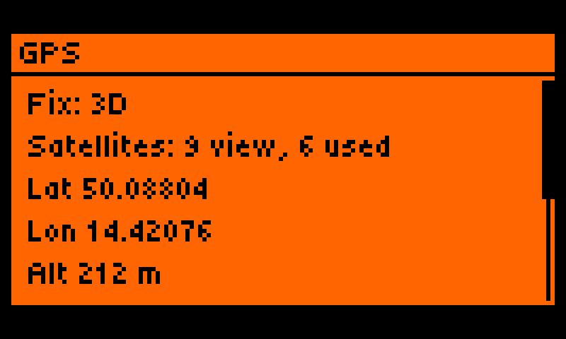

# gothi-gps

A module for [gothi](https://github.com/n900-resurrection/n900-gothi): the entry **GPS** in the menu **Modules** shows the state of the GPS while its page is open: whether there is a fix (none, 2D, 3D), the satellites in view and in use and, with a fix, the position, altitude, speed, track and error. Leaving the page switches the GPS off again (so it does not drain the battery).

| searching | fix |
|---|---|
|  |  |

*(Screenshots are rendered on a computer with the same code and made-up data; the position is a place in a city centre.)*

**The GPS needs a view of the sky.** In a flat in a block it sees no satellites (neither does a Garmin); try it outdoors or at a window and give it a few minutes for the first fix. The screen says so after 30 seconds without a satellite.

How it works: gothi has the kind of module `monitor` (a command that runs while the page is open, every block of lines closed by an empty line replaces the page). The command is `module/gps-stream.py`, a small Python **2.5** script, because only the Python of Maemo has the module `location` (the binding of liblocation, package `python-location`). It starts the GPS with the satellite method only (`METHOD_GNSS`, no network assistance, nothing is sent anywhere), and it **turns the system switch of the GPS on for the time of the run** (`/system/nokia/location/gps-disabled`, Settings > Location) and puts the old value back at the end, also when it is stopped. The position that the system remembers from the last time is not shown as if it were live; only a real fix is.

## A-GPS (a faster first fix)

The satellites only broadcast their orbits slowly (about 30 seconds per satellite at a strong signal), so a **cold start without help takes 5 to 15 minutes** on the N900. With **A-GPS** the phone downloads the orbits from a *SUPL server* and the first fix takes seconds to a minute. The entry **GPS (A-GPS)** in the menu Modules does that (the same helper with `--assisted`; the page also shows the time of the search and a hint while there is no fix).

- **Something leaves the phone**: the server learns the cell the phone is in (that is what makes A-GPS work). The plain entry **GPS** stays satellite-only.
- The server of the system, `supl.nokia.com`, does not exist any more. The default here is `supl.google.com:7275`; another one can be given as `python2.5 /opt/gothi/modules/gps/gps-stream.py --assisted host:port`. Forum reports about which public server still works are old and mixed, so **this is an experiment**: if the page keeps saying "Need 3 satellites in use" the server did not help.
- For the time of the run the helper sets the keys `/system/nokia/location/supl/server`, `.../supl/port` and `.../network-disabled` and puts the old values back at the end (the test checks it).
- The format of the Garmin watches (EPO/CPE files) cannot be used: it belongs to other chips; the GPS of the N900 sits in the modem and takes assistance data only through SUPL.

## GPS track: record where you went, export GPX

The entry **GPS track** in the menu Modules records a track and exports it as a **GPX 1.1** file. The recording runs in a **background process** (`module-track/recorder.py`), so it goes on when gothi is closed and the screen is off: start it, put the phone in a pocket, walk.

- **Record**: OK starts and stops; the screen shows the time, the distance, the points kept and the fix (`3D fix 6/9 sat`, or `searching` with the satellites in use and in view). **Record with A-GPS** does the same with the helper in the A-GPS mode (see above) and asks first, because that one talks to a server.
- **Tracks**: the recorded tracks, the newest first. A track has **Statistics** (points, distance, time, average and top speed, altitude, climbed metres), **Export GPX** and **Delete**.
- The GPX is also written **automatically when the recording stops**, next to the track file.
- A recording **without a fix is not kept**: if the GPS never found the satellites, no empty track is left behind.

Files are in `~/MyDocs/gothi/tracks/` (on the phone: `/home/user/MyDocs/gothi/tracks`, which is what the USB storage mode and a file server show): `track-YYYYMMDD-HHMMSS.jsonl` is the track as it is written (one JSON per line, flushed at once, so a dead battery loses nothing; a half-written last line is skipped), `track-....gpx` is the export. The GPX has one `trk` with one `trkseg`, and for each point the latitude and longitude, the altitude (with a 3D fix), the time (UTC), the fix (`2d` / `3d`) and the number of satellites in use.

Which fixes are kept (`tracklib.py`): at least 5 m and 2 s after the last kept one, and one every 30 s even when standing still; a fix that says it is worse than 100 m is dropped, and so is a jump that would need more than 430 km/h. The recording stops by itself after 8 hours. The altitude of a GPS jitters, so a climb counts only in steps of 3 m.

A recording needs a GPS fix, which needs the open sky: see the cold start above (5 to 15 minutes without A-GPS). **The recorder has been tested with a fake GPS (made-up fixes) and on the phone indoors, where there is no fix; a real track under the open sky is still to be tried** ([#18](https://github.com/n900-resurrection/n900-gothi/issues/18)). The positions are personal data and stay on the phone; the module sends nothing anywhere, except in the A-GPS mode.

For other modules (the planned wardriving, [#16](https://github.com/n900-resurrection/n900-gothi/issues/16)) the recorder keeps its state in `~/.cache/gothi/gps-track.json` (the latest fix, the satellites, the number of points and the distance, written every second), and `gps-stream.py --raw` prints one machine-readable line per half second: `FIX <mode> <lat> <lon> <alt> <speed km/h> <track> <error m> <time> <in view> <in use>` (`nan` where a value is not known), or `ERR <code>`.

Tests: `python3 -m unittest discover -s tests` on a computer (50 tests: the parser, the filter, the file, the statistics, the GPX read back as XML, the real background process with a fake helper, all the screens) and `make test` on the phone.

Package: `gothi-gps`, depends on `gothi (>= 0.11.0)`, `python-location` and `python3.11`.
