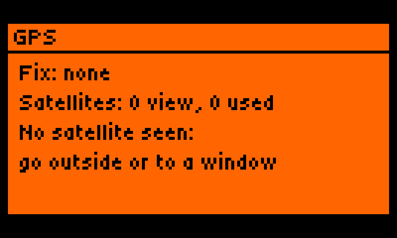

# gothi-gps

A module for [gothi](https://github.com/n900-resurrection/n900-gothi): the entry **GPS** in the menu **Modules** shows the state of the GPS while its page is open: whether there is a fix (none, 2D, 3D), the satellites in view and in use and, with a fix, the position, altitude, speed, track and error. Leaving the page switches the GPS off again (so it does not drain the battery).

| searching | fix |
|---|---|
|  |  |

*(Screenshots are rendered on a computer with the same code and made-up data; the position is a place in a city centre.)*

**The GPS needs a view of the sky.** In a flat in a block it sees no satellites (neither does a Garmin); try it outdoors or at a window and give it a few minutes for the first fix. The screen says so after 30 seconds without a satellite.

How it works: gothi has the kind of module `monitor` (a command that runs while the page is open, every block of lines closed by an empty line replaces the page). The command is `module/gps-stream.py`, a small Python **2.5** script, because only the Python of Maemo has the module `location` (the binding of liblocation, package `python-location`). It starts the GPS with the satellite method only (`METHOD_GNSS`, no network assistance, nothing is sent anywhere), and it **turns the system switch of the GPS on for the time of the run** (`/system/nokia/location/gps-disabled`, Settings > Location) and puts the old value back at the end, also when it is stopped. The position that the system remembers from the last time is not shown as if it were live; only a real fix is.

Package: `gothi-gps`, depends on `gothi (>= 0.7.0)` and `python-location`.
